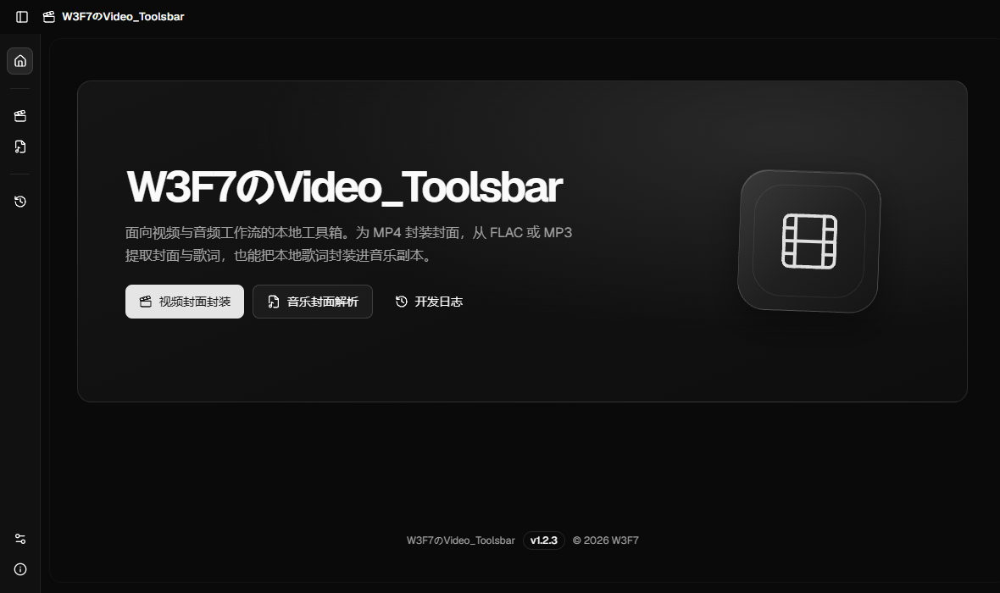
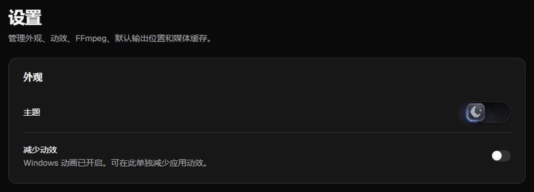
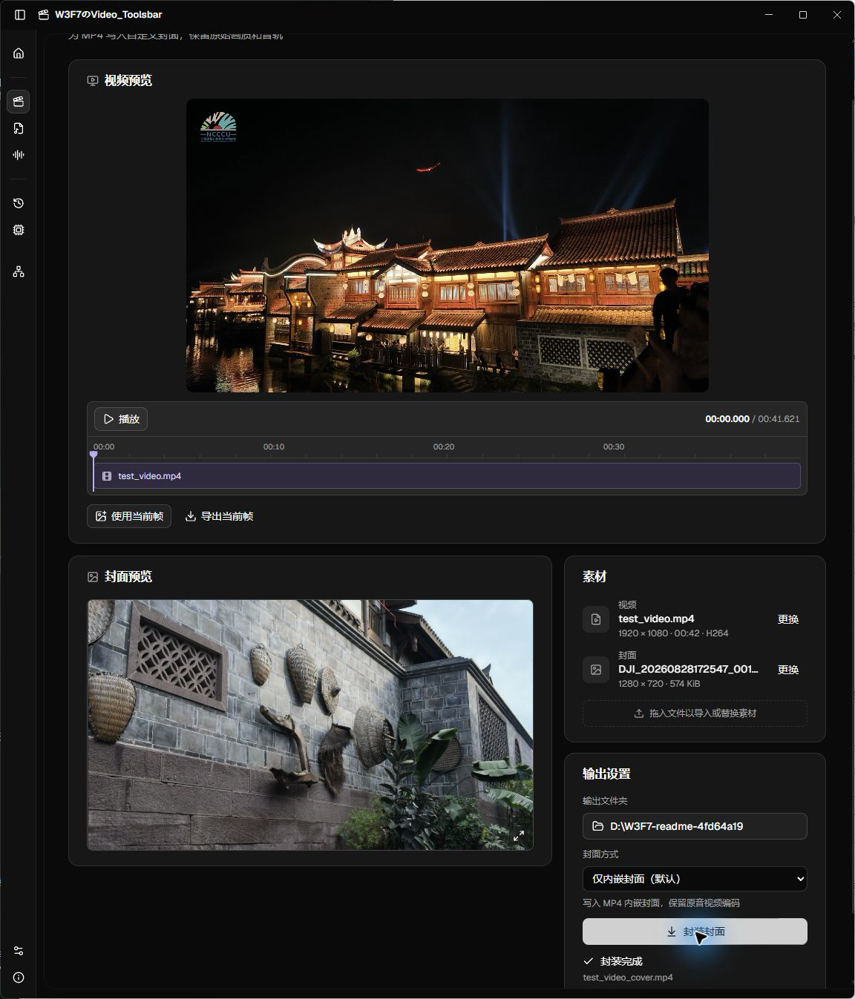
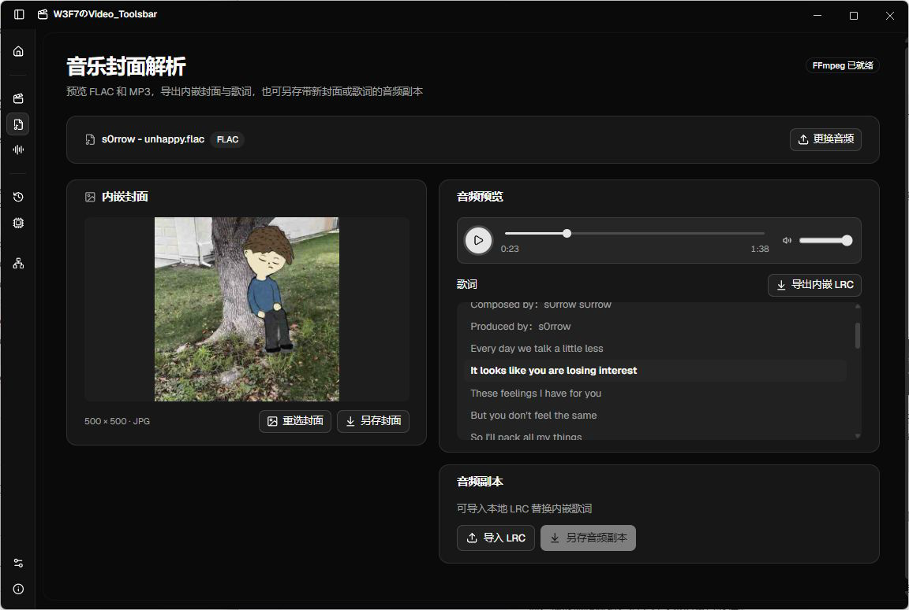

<div align="center">

# W3F7のVideo_Toolsbar

**面向视频与音频工作流的本地工具箱。**

Windows x64 安装版与便携版 **v1.2.3**

[](https://github.com/PowerT-0704/W3F7-Video-Toolsbar/releases/latest)
[](https://github.com/PowerT-0704/W3F7-Video-Toolsbar/releases)
[](https://github.com/PowerT-0704/W3F7-Video-Toolsbar/releases/latest)
[](LICENSE)
[](https://ffmpeg.org/download.html#build-windows)

[📦 Windows x64 安装版](https://github.com/PowerT-0704/W3F7-Video-Toolsbar/releases/download/v1.2.3/W3F7-Video-Toolsbar-1.2.3-Setup-x64.exe) · [便携版 ZIP](https://github.com/PowerT-0704/W3F7-Video-Toolsbar/releases/download/v1.2.3/W3F7-Video-Toolsbar-1.2.3-win-x64.zip) · [发布说明与校验值](https://github.com/PowerT-0704/W3F7-Video-Toolsbar/releases/tag/v1.2.3)

[界面预览](#界面预览) · [功能展示](#功能展示) · [快速开始](#快速开始) · [开发路线图](ROADMAP.md) · [历史验收记录](docs/verification.md)

</div>

## 界面预览

<p align="center"></p>

### 🌗 深浅主题

在「设置 → 外观」拖动开关，月亮与太阳随滑块交替，页面即时换色。松手后，滑块吸附到选中的主题。深色切浅色时，流光沿滑块下边和右边移动，切回深色时沿上边和左边回到起点，完成一圈逆时针运动。

<p align="center"></p>

## 功能展示

### 🎬 视频封面封装

在 MP4 时间轴上定位画面，把当前帧或本地图片封装成封面，保留原有音视频编码。

<p align="center"></p>

### 🎵 音乐封面解析

试听 FLAC 或 MP3，导出原封面与内嵌歌词。裁剪新封面或导入 LRC 后，可一起写入同格式的音频副本。

<p align="center"></p>

## 快速开始

### 下载与启动

- **安装版**按中文向导选择目录。默认安装在当前用户的 `%LOCALAPPDATA%\Programs\W3F7-Video-Toolsbar`，开始菜单会添加入口，可自行勾选桌面快捷方式。安装程序未签名。
- **便携版**完整解压 ZIP 后运行 `W3F7-Video-Toolsbar.exe`。从首页或侧栏进入工具，页面会显示 FFmpeg 和 FFprobe 的检测结果。
- 可从 Windows「设置 → 应用」或开始菜单运行卸载程序。卸载时保留个人设置和自己生成的文件。

### 准备 FFmpeg

1. 从 [FFmpeg 官方下载页](https://ffmpeg.org/download.html#build-windows) 进入 Windows 构建下载。把压缩包解压到固定目录，确认 `bin` 里同时有 `ffmpeg.exe` 和 `ffprobe.exe`。
2. 将 `bin` 的绝对路径加入 Windows 用户 PATH，重开终端和工具，执行 `ffmpeg -version` 与 `ffprobe -version`。桌面版也能在「设置 → FFmpeg」直接选择 `bin` 文件夹。
3. FFmpeg 用于视频封装、抽帧和音乐封面提取，FFprobe 用于识别媒体和校验成品。安装版与便携版均使用外置 FFmpeg。

### 视频封面封装

把 MP4 和封面拖入虚线区域，可以一起拖，也可以逐个拖。页面会识别视频和 PNG、JPG、JPEG 封面，并分别显示到素材列表。也可以用「选择视频」「选择封面」导入。确认预览及保存位置，点击「封装封面」。完成后点击「在资源管理器中查看」。

### 音乐封面解析

1. 从起始页或侧栏打开「音乐封面解析」，选择或拖入一首 FLAC 或 MP3。可试听、拖动进度、另存内嵌封面原图或导出 UTF-8 LRC。
2. 通过「重选封面」导入 JPG、JPEG 或 PNG。非方图可拖动选框或调整选区大小。新正面封面为 1:1，边长最多 1000 px，体积最多 1 MiB，透明 PNG 保留透明度。
3. 导入本地 LRC 可立即预览歌词，带时间戳的歌词随播放高亮。切离音乐页时暂停，返回可从原进度继续。
4. 点击「另存音频副本」写入待封装的封面或歌词。两项可一次保存，原始音频数据和其他附图跟随副本保留。

### 单文件批处理

选中一个 MP4 与一张静态 PNG/JPG/JPEG，一起拖到 [W3F7-Video-Cover.bat](W3F7-Video-Cover.bat)。脚本自动识别拖放顺序，在批处理文件所在目录生成 `原名_cover.mp4`。同名会生成 `原名_cover_2.mp4` 等编号文件。Windows 自带的 PowerShell 会运行脚本内嵌的处理核心。

## 设置与更新

- 鼠标移入左侧图标栏可展开导航。用顶部按钮或 `Ctrl+B` 固定展开，点击工作区空白处收回。窄窗可通过顶部按钮打开抽屉。
- 设置页的标题与卡片在侧栏右侧的工作区居中。
- 深浅主题会在下次启动时恢复。主题过渡和音乐页流光遵循应用的「减少动效」及 Windows 动画设置。[微软动画设置说明](https://support.microsoft.com/zh-cn/accessibility/windows/make-it-easier-to-focus-on-tasks)
- 「设置 → 存储与缓存」可查看抽帧和临时封面的占用、迁移缓存位置或清理闲置缓存。
- 应用会在启动后查询 GitHub 上的最新正式版，也可在「关于 → 检查更新」手动查询。

## 封装与兼容性

### 视频

- FFmpeg 写入 MP4 的内嵌封面，视频、音频和其他兼容轨使用流复制。原始视频和封面文件保留。已有内嵌封面时，成品使用新图。
- 支持静态 PNG、JPG、JPEG。图像会先解码校验，再以原始图像数据写入封面。章节按原章节表保存。样片的时间码轨按原时间码重建并校验。
- 导出用同目录临时文件，媒体轨无法复制或成品校验失败时会显示错误。再次导出可使用同样的素材。
- 各播放器和上传平台采用各自的缩略图规则。内嵌封面跟随 MP4 文件保存。

### 音乐

- 封装生成 FLAC 或 MP3 副本。新封面写入正面封面标签，背面等其他附图保留。
- LRC 导入支持 UTF-8、带 BOM 的 UTF-16 和 GB18030，导出使用 UTF-8。MP3 的毫秒制 SYLT 歌词可转成 LRC，播放器能否显示歌词取决于其标签支持。
- 源图读取上限为 64 MiB。遇到受保护或无法安全改写的标签时，音乐页会说明封装限制。

## 资源管理器缩略图

在本机 Windows 11 的原生文件选择器中，样片的内嵌 PNG 已显示为 MP4 缩略图。在其他机器上，可切换到资源管理器的「大图标」视图，打开新导出文件所在的目录复验。若缩略图仍取自视频画面，可手动配置 [Icaros](https://github.com/Xanashi/Icaros)。

1. 从 [Icaros Releases](https://github.com/Xanashi/Icaros/releases) 获取并打开 IcarosConfig。
2. 在 **Thumbnailing** 中将 `.mp4` 加入已启用的类型，打开 **Use embedded Cover Art for thumbnails**，然后启用 **Thumbnailing**。
3. 用工具再导出一份新文件名的 MP4，在资源管理器的大图标视图核对所选封面。新文件名可以避开已有缩略图缓存。

## 从源码运行

在 Windows x64 上使用 Node.js 24 与 FFmpeg。构建时会根据锁文件安装依赖。

```powershell
npm ci
node node_modules/electron/install.js
npm start
```

- `npm start` 会先构建桌面应用，再启动 Electron。
- `npm run build:bat` 更新单文件批处理。原始封装逻辑在 `core/cover.ps1`。
- `npm run typecheck` 运行 TypeScript 检查。 `npm run package:win` 构建可解压运行的 ZIP，输出到 `artifacts`。
- 音乐标签回归测试可在 `npm run build:app` 后运行 `node --test tests/music.test.cjs`，测试使用 PATH 中的 FFmpeg 和 FFprobe。
- `npm run package:installer` 使用当前版本的便携 ZIP 构建安装版。需要 NSIS 3，将 `makensis.exe` 加入 PATH，或将 `W3F7_MAKENSIS` 设置为编译器的绝对路径。
- FFmpeg 支持和本地文件操作由 Electron 主进程提供。界面包括视频封面封装、音乐封面解析、开发日志、设置与关于。
- 原始样片、验收视频、便携 ZIP 与本地备份保留在工作区。可从 Git 快照重建交付包。

## 致谢

界面使用 [shadcn/ui](https://github.com/shadcn-ui/ui) 官方 New York 组件和 Neutral 暗色主题，搭配 [Geist](https://github.com/vercel/geist-font) 字体。关于页的头像来自 [W3F7 的 GitHub 主页](https://github.com/PowerT-0704)，随应用本地打包。切页、拖入和按钮反馈使用 Motion 和 Magic UI，柔光参照 React Bits。第三方许可见 [licenses](licenses/)。

项目源码采用 [MIT 许可](LICENSE)。第三方组件、字体和随附图片适用各自的权利声明。

**作者** [W3F7 · PowerT-0704](https://github.com/PowerT-0704)
