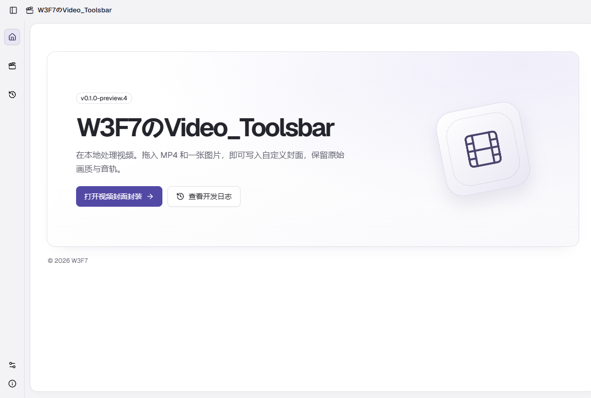

<div align="center">

# W3F7のVideo_Toolsbar

**给 MP4 装上自己的封面，保留视频和音频的原始编码。**


[快速开始](#快速开始) · [资源管理器缩略图](#资源管理器缩略图) · [开发路线图](ROADMAP.md) · [验收记录](docs/verification.md)

</div>

<div align="center">


</div>

## 快速开始

### 准备 FFmpeg

1. 从 [FFmpeg 官方下载页](https://ffmpeg.org/download.html#build-windows) 进入 Windows 构建下载。把压缩包解压到固定目录，确认 `bin` 里同时有 `ffmpeg.exe` 和 `ffprobe.exe`。
2. 将 `bin` 的绝对路径加入 Windows 用户 PATH，重开终端和工具，执行 `ffmpeg -version` 与 `ffprobe -version`。桌面版也能在「设置 → FFmpeg」直接选择 `bin` 文件夹。
3. FFmpeg 负责复制音视频轨并写入封面，FFprobe 负责识别轨道、验证成品。便携包使用外置 FFmpeg。

### 桌面便携版

完整解压 Windows x64 ZIP 后打开 `W3F7-Video-Toolsbar.exe`。启动后进入起始页，可从首页或侧栏打开「视频封面封装」。FFmpeg 和 FFprobe 在后台自动检测，结果显示在工具页。

将鼠标移到左侧图标栏可展开导航，移开后会收回。用顶部按钮或 `Ctrl+B` 固定展开。窄窗口用顶部按钮打开抽屉。在「设置 → 外观」可以切换深色和浅色，也可以减少动效。主题选择会在下次启动时恢复。

把 MP4 和封面拖入虚线区域，可以一起拖，也可以逐个拖。页面会识别视频和 PNG、JPG、JPEG 封面，并分别显示到素材列表。也可以用「选择视频」「选择封面」导入。确认预览及保存位置，点击「封装封面」。完成后点击「在资源管理器中查看」。

### 单文件批处理

选中一个 MP4 与一张静态 PNG/JPG/JPEG，一起拖到 [W3F7-Video-Cover.bat](W3F7-Video-Cover.bat)。脚本自动识别拖放顺序，在批处理文件所在目录生成 `原名_cover.mp4`。同名会生成 `原名_cover_2.mp4` 等编号文件。Windows 自带的 PowerShell 会运行脚本内嵌的处理核心。

## 封装与兼容性

- FFmpeg 写入 MP4 的内嵌封面，视频、音频和其他兼容轨使用流复制。原始视频和封面文件保留。已有内嵌封面时，成品使用新图。
- 支持静态 PNG、JPG、JPEG。图像会先解码校验，再以原始图像数据写入封面。章节按原章节表保存。样片的时间码轨按原时间码重建并校验。
- 导出用同目录临时文件，媒体轨无法复制或成品校验失败时会显示错误。再次导出可使用同样的素材。
- 各播放器和上传平台采用各自的缩略图规则。内嵌封面跟随 MP4 文件保存。

## 资源管理器缩略图

在本机 Windows 11 的原生文件选择器中，样片的内嵌 PNG 已显示为 MP4 缩略图。在其他机器上，可切换到资源管理器的「大图标」视图，打开新导出文件所在的目录复验。若缩略图仍取自视频画面，可手动配置 [Icaros](https://github.com/Xanashi/Icaros)。

1. 从 [Icaros Releases](https://github.com/Xanashi/Icaros/releases) 获取并打开 IcarosConfig。
2. 在 **Thumbnailing** 中将 `.mp4` 加入已启用的类型，打开 **Use embedded Cover Art for thumbnails**，然后启用 **Thumbnailing**。
3. 用工具再导出一份新文件名的 MP4，在资源管理器的大图标视图核对所选封面。新文件名可以避开已有缩略图缓存。

## 从源码运行

在 Windows x64 上使用 Node.js 24 与 FFmpeg。构建时会根据锁文件安装依赖。

```powershell
npm ci
node node_modules/electron/install.js
npm start
```

- `npm start` 会先构建桌面应用，再启动 Electron。
- `npm run build:bat` 更新单文件批处理。原始封装逻辑在 `core/cover.ps1`。
- `npm run typecheck` 运行 TypeScript 检查。 `npm run package:win` 构建可解压运行的 ZIP，输出到 `artifacts`。
- FFmpeg 支持和本地文件操作由 Electron 主进程提供。界面包括起始页、封面工具、开发日志、设置与关于。
- 原始样片、验收视频、便携 ZIP 与本地备份保留在工作区。可从 Git 快照重建交付包。

## 致谢

界面使用 [shadcn/ui](https://github.com/shadcn-ui/ui) 官方 New York 组件和 Neutral 暗色主题，搭配 [Geist](https://github.com/vercel/geist-font) 字体。关于页的头像来自 [W3F7 的 GitHub 主页](https://github.com/PowerT-0704)，随应用本地打包。切页、拖入和按钮反馈使用 Motion 和 Magic UI，柔光参照 React Bits。第三方许可见 [licenses](licenses/)。

**作者** [W3F7 · PowerT-0704](https://github.com/PowerT-0704)
